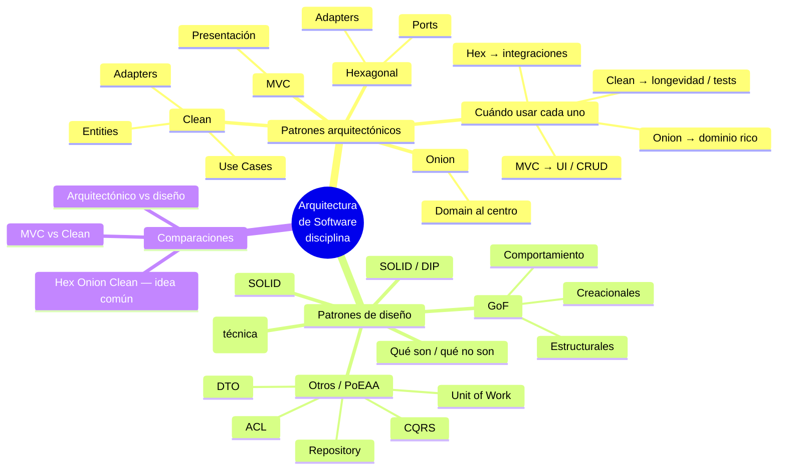
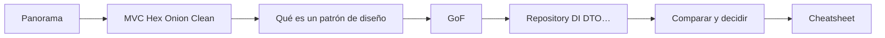
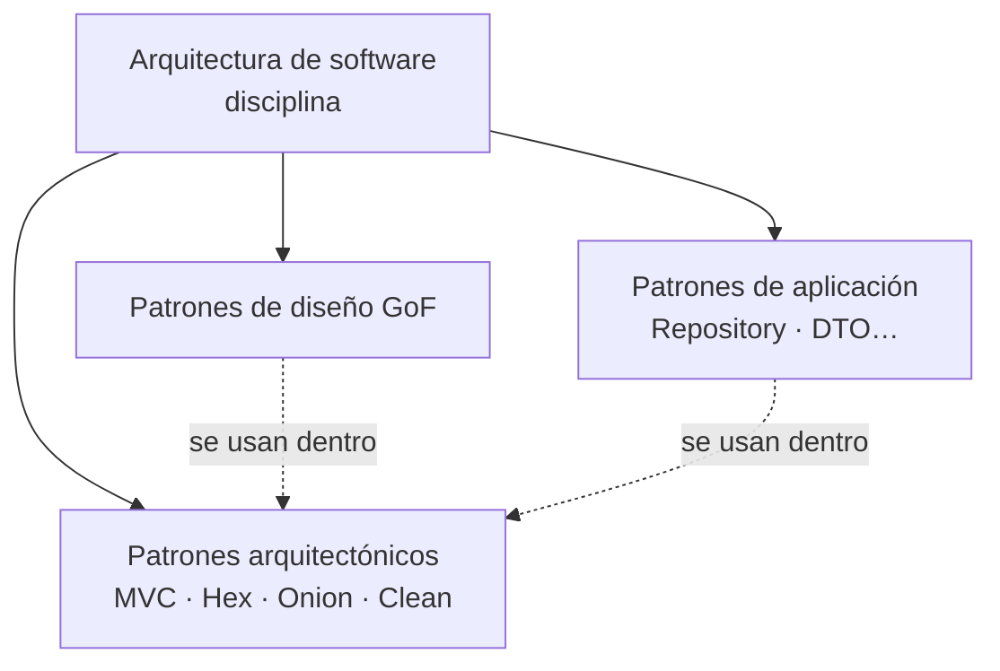

  

<strong>Nociones patrones arquitectónicos y diseño</strong> · Pascual Bravo · Versión 2026-II

# 0. Mapa mental — antes de empezar

Panorama de los temas, antes de profundizar.

## Vista general

## Orden de estudio

## Relación entre conceptos

Primero se parte la aplicación (patrón arquitectónico). Después, dentro de esas capas, se resuelven problemas locales con patrones de diseño y de aplicación.

---

**Siguiente →** [01-patrones-arquitectonicos.md](01-patrones-arquitectonicos.md)
