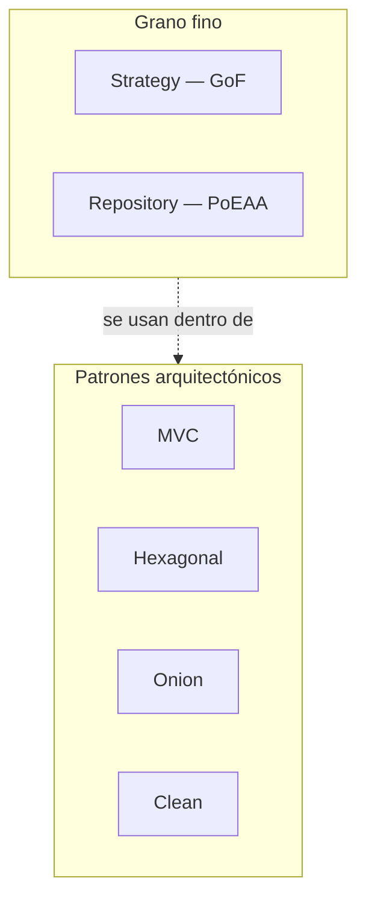
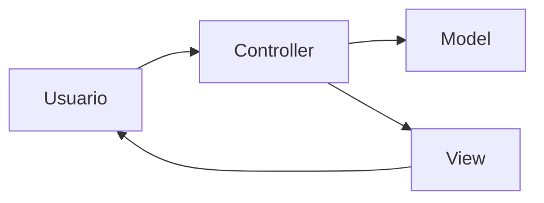
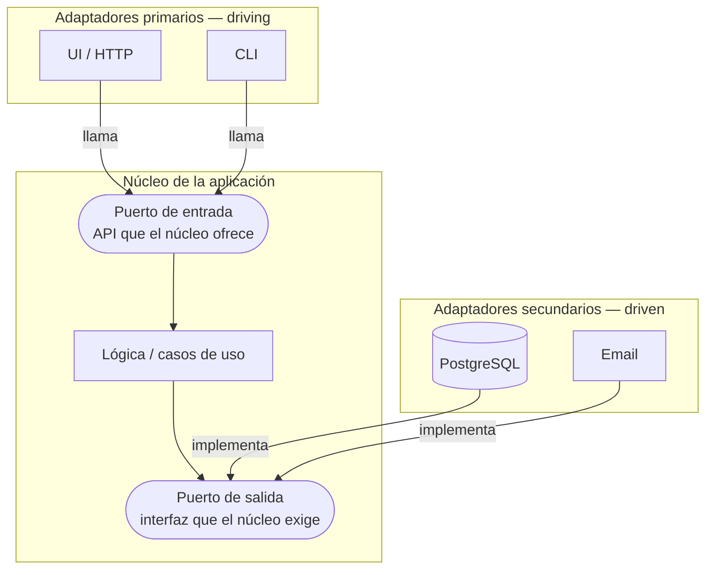
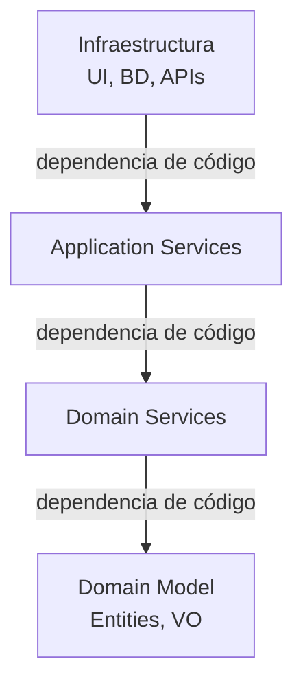
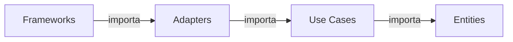
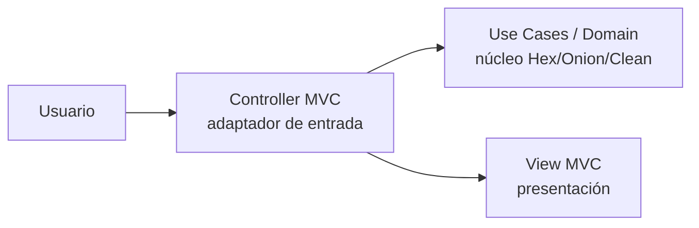
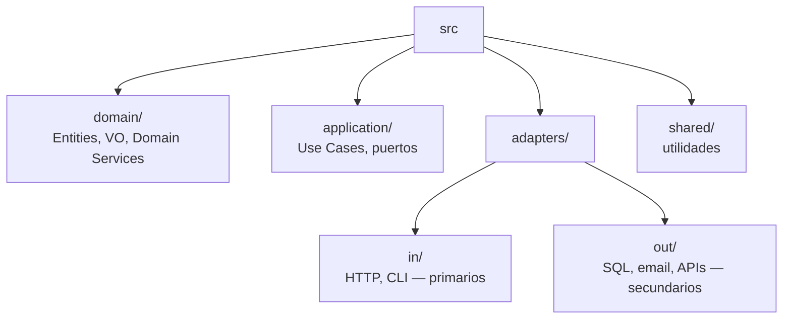

# 1. Patrones arquitectónicos: MVC, Hexagonal, Onion, Clean

## 1.0 Qué son MVC, Hexagonal, Onion y Clean

Son **patrones arquitectónicos** (también: *patrones de arquitectura*), en el sentido de POSA: soluciones reutilizables a la **organización de una aplicación** (capas + dependencias).

| Término | Qué es | Ejemplo |
|---------|--------|---------|
| **Arquitectura de software** | Disciplina de organizar un sistema (el resultado también se llama “la arquitectura” del producto) | Capas, dependencias y patrones aplicados |
| **Patrón arquitectónico** | Organización de la app (capas + dependencias) | MVC, Hexagonal, Onion, Clean |
| **Patrón de diseño** | Problema local de clases/objetos (GoF) — se ve en el §2–3 | Strategy, Adapter |
| **Patrón de aplicación** | Grano fino (p. ej. PoEAA) — se ve en el §4 | Repository, DTO |

Los nombres propios *Clean Architecture* (Martin, ensayo 2012; libro 2017) y *Onion Architecture* (Palermo) designan propuestas concretas; su categoría es patrón arquitectónico.

| | Patrón arquitectónico | Patrón de diseño |
|--|------------------------|------------------|
| Nivel | Capas y módulos de la aplicación | Clases y objetos |
| Pregunta | ¿Cómo se parte la app y quién importa a quién? | ¿Cómo colaboran estas clases? |

Los cuatro de este capítulo:

1. **MVC** — presentación (entrada ↔ estado ↔ vista).  
2. **Hexagonal** — núcleo + **puertos/adaptadores**.  
3. **Onion** — capas en cebolla, **dominio al centro**.  
4. **Clean** — anillos + **casos de uso**, dependencias hacia adentro.



### Qué **no** son

| No son… | Porque… |
|---------|---------|
| Patrones de diseño GoF | Otro nivel (clases, no capas de app) |
| Frameworks | Puedes aplicar Clean sin Spring |
| Microservicios / SOA / cliente-servidor | Otro nivel de organización de sistemas |

### Qué define un patrón arquitectónico

1. **Capas / módulos** (responsabilidades).  
2. **Dependencias de código** (quién puede **importar** a quién).  

En Hexagonal, Onion y Clean se añade: el **dominio** queda protegido al centro.

### Dependencia de código ≠ flujo de ejecución

| | Pregunta | Ejemplo |
|--|----------|---------|
| **Dependencia de código** | ¿Quién *importa* a quién? | El controller importa el caso de uso; el dominio **no** importa Express |
| **Flujo de ejecución** | ¿Quién *llama* a quién en runtime? | Request → controller → caso de uso → repositorio |

Las “flechas hacia adentro” en Hex/Onion/Clean indican **dependencia de código**.

Regla que comparten Hexagonal, Onion y Clean:

> El dominio **no** importa frameworks, UI ni base de datos.  
> Las capas externas dependen de las internas (no al revés).

---

## 1.1 MVC (Model–View–Controller)

**Categoría:** patrón arquitectónico (presentación).  
**Origen:** Trygve Reenskaug (Smalltalk). Muy usado en web (Rails, ASP.NET MVC, Spring MVC, Laravel…).

### Roles

| Rol | Responsabilidad |
|-----|-----------------|
| **Model** | Estado y reglas que MVC considera “del modelo” (datos + lógica asociada) |
| **View** | Presentación (HTML, UI) |
| **Controller** | Recibe la entrada del usuario y orquesta Model / View |

> Si combinas MVC con Hex/Onion/Clean, el **Model gordo desaparece**: las reglas pasan a entidades/casos de uso; el controller MVC queda como **adaptador** de UI.



### Ejemplo

```ts
// Controller
class PedidoController {
  constructor(private pedidos: PedidoService) {}
  crear(req: Request, res: Response) {
    const pedido = this.pedidos.crear(req.body);
    res.render("pedido-ok", { pedido }); // View
  }
}
```

### Fortalezas y límites

| Bien para | Cuidado con |
|-----------|-------------|
| Apps con UI clara (web/desktop) | Controllers “gordos” (toda la lógica ahí) |
| Separar presentación de entrada | Creer que MVC basta como único patrón arquitectónico de toda la app |

**MVC organiza la capa de presentación.** No define por sí solo cómo aislar dominio, BD y APIs externas. Por eso en apps con reglas se combina con Hexagonal/Onion/Clean **detrás** del controller.

---

## 1.2 Hexagonal (Ports & Adapters)

**Categoría:** patrón arquitectónico.  
**Origen:** Alistair Cockburn. También llamado **Ports and Adapters**.

### Idea

El núcleo de la aplicación (lógica de negocio / casos de uso) queda aislado.  
Todo lo externo (HTTP, BD, email, cola) se conecta por **puertos**; las tecnologías concretas son **adaptadores** (Cockburn: *Ports & Adapters*).



El adaptador **primario llama** al puerto de entrada; el adaptador **secundario implementa** el puerto de salida. El núcleo no conoce Postgres ni SMTP.

> **No confundir** con el patrón de diseño **Adapter (GoF)** del §3: allí es una clase que traduce una interfaz a otra. Aquí “adaptador” es el componente del borde (HTTP, SQL…) que conecta el exterior con un puerto.

### Puertos

| Tipo | Quién inicia | Rol del adaptador | Ejemplo |
|------|--------------|-------------------|---------|
| **Primario (driving)** | El exterior conduce la app | **Llama** a la API del núcleo | Controller HTTP → `CrearPedido` |
| **Secundario (driven)** | La app conduce al exterior | **Implementa** la interfaz del núcleo | `PedidoRepoSql` implementa `PedidoRepository` |

### Ejemplo

```ts
// Puerto (secundario) — lo define la app
interface PedidoRepository {
  guardar(p: Pedido): Promise<void>;
}

// Caso de uso (dentro del hexágono)
class CrearPedido {
  constructor(private repo: PedidoRepository) {}
  async ejecutar(cmd: { items: string[] }) {
    const p = Pedido.nuevo(cmd.items);
    await this.repo.guardar(p);
  }
}

// Adaptador — detalle técnico
class PedidoRepoSql implements PedidoRepository {
  async guardar(p: Pedido) { /* INSERT */ }
}

// Adaptador primario
class PedidoHttpController {
  constructor(private crear: CrearPedido) {}
  async post(body: any) { await this.crear.ejecutar(body); }
}
```

Si cambias PostgreSQL por Mongo, solo cambias el **adaptador**. El caso de uso no se entera.

---

## 1.3 Onion

**Categoría:** patrón arquitectónico.  
**Origen / nombre:** Jeffrey Palermo (*The Onion Architecture*).

### Idea

Capas en **cebolla**. El centro es el dominio. Cada capa solo conoce las **interiores**.



*Capa externa → importa → capa más interna. El Domain Model no importa infraestructura.*

### Reglas

1. El **modelo de dominio** no depende de nada externo.  
2. Las interfaces de persistencia se declaran hacia adentro (domain/application); el SQL queda en infraestructura.  
3. UI y BD son **periferia**, no el centro.

Onion y Hexagonal son **primos cercanos**: misma idea de dependencias; Onion se dibuja en capas concéntricas.

---

## 1.4 Clean (Clean Architecture)

**Categoría:** patrón arquitectónico (nombre propio: *Clean Architecture*).  
**Origen:** Robert C. Martin — ensayo (2012) y libro *Clean Architecture* (2017). Relaciona de forma explícita ideas de Hexagonal, Onion y similares.

### Capas típicas (de adentro hacia afuera)

| Capa | Contiene |
|------|----------|
| **Entities** | Reglas de negocio de la empresa (más estables) |
| **Use Cases** | Reglas de la aplicación (flujos concretos) |
| **Interface Adapters** | Controllers, Presenters, Gateways, mappers |
| **Frameworks & Drivers** | Web, BD, dispositivos, frameworks |

### Regla de dependencia (la más importante)

> El código fuente solo puede apuntar **hacia adentro**.  
> Nada de una capa interna debe conocer nombres, tipos o frameworks de una capa externa.



*Solo dependencia de código (quién importa a quién). Siempre hacia el centro.*

### Ejemplo

```ts
// Entity (centro)
class Cuenta {
  constructor(public saldo: number) {}
  debitar(monto: number) {
    if (monto > this.saldo) throw new Error("Fondos insuficientes");
    this.saldo -= monto;
  }
  acreditar(monto: number) {
    this.saldo += monto;
  }
}

// Use Case
class Transferir {
  constructor(private cuentas: CuentaGateway) {}
  async ejecutar(from: string, to: string, monto: number) {
    const a = await this.cuentas.obtener(from);
    const b = await this.cuentas.obtener(to);
    a.debitar(monto);
    b.acreditar(monto);
    await this.cuentas.guardar(a, b);
  }
}

// Adapter (controller) — solo traduce HTTP → caso de uso
```

Entities y Use Cases se pueden testear **sin** levantar Spring, Express o Django.

---

## 1.5 ¿Hexagonal ≈ Onion ≈ Clean?

**No son el mismo patrón**, pero **comparten la misma idea central:** el dominio no depende de frameworks; las dependencias apuntan hacia adentro. Martin presenta Clean como una síntesis afín a Hexagonal y Onion.

| | Hexagonal | Onion | Clean |
|--|-----------|-------|-------|
| Metáfora | Puertos y adaptadores | Capas de cebolla | Anillos + use cases |
| Énfasis | Bordes tecnológicos | Capas y dominio en el centro | Flujos de aplicación + regla de dependencia |
| Autor | Cockburn | Palermo | Martin |

En la práctica, muchos equipos usan “Clean/Hexagonal” como sinónimo informal de: **dominio adentro, adapters afuera**.

---

## 1.6 Dónde encaja MVC



MVC **no compite** con Clean: al combinarlos, el Controller/View quedan en el **borde** (adaptadores de UI); el dominio y los casos de uso viven **dentro**.

---

## 1.7 Estructura de carpetas (Clean / Hexagonal)



Nombres varían; la **dirección de dependencias** no.

---

## 1.8 Cuándo usar cada patrón

| Patrón | Tipo de aplicación | Cuándo encaja | Cuándo no conviene |
|--------|--------------------|---------------|---------------------|
| **MVC** | Web tradicional, paneles, CRUD con UI | Separar entrada, estado y vista; prototipos y sistemas pequeños | Dominio complejo o muchas integraciones (pago, ERP, colas…) |
| **Hexagonal** | APIs y sistemas con varios canales (HTTP, CLI, mensajes) | Aislar el núcleo y cambiar BD, email o pasarelas sin tocar el negocio | Una sola pantalla o un CRUD mínimo |
| **Onion** | Aplicaciones de negocio con dominio rico | Dominio en el centro; infraestructura en la periferia | Proyectos muy pequeños donde tantas capas no aportan |
| **Clean** | Sistemas de mediana/larga duración con reglas y tests | Dominio testeable sin frameworks; flujos de aplicación claros | Demos, blogs simples o scripts de una sola función |

Hexagonal, Onion y Clean se pueden combinar con **MVC en el borde** (controllers/views como adapters de UI).

---

**Anterior:** [00-mapa-mental.md](00-mapa-mental.md) · **Siguiente:** [02-patrones-de-diseno.md](02-patrones-de-diseno.md)
