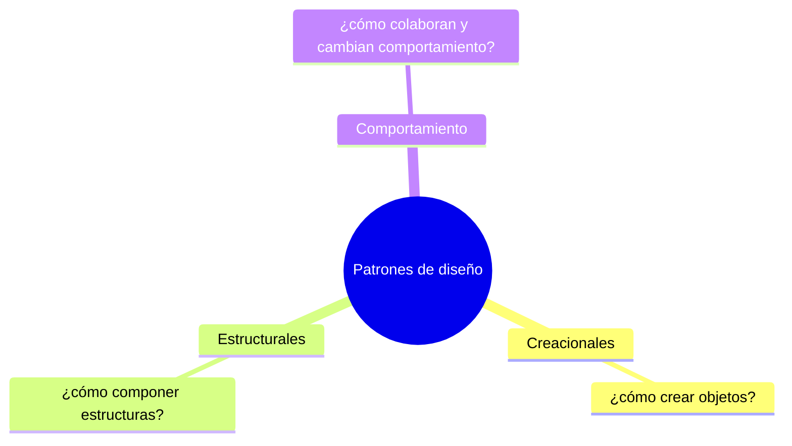

# 2. Patrones de diseño

Ya viste cómo **partir** la aplicación (MVC, Hexagonal, Onion, Clean). Ahora: soluciones **locales** de clases y objetos que viven **dentro** de esas capas.

## 2.1 ¿Qué es un patrón de diseño?

Un **patrón de diseño** es una **solución reutilizable** a un problema de diseño que aparece una y otra vez en el desarrollo de software.

No es código copiable tal cual. Es un **molde** (estructura + roles + relaciones) que adaptas a tu contexto.

> Analogía: “habitación con cocina americana” no te da planos exactos; te da una **forma conocida** de organizar el espacio.

## 2.2 Por qué existen

Sin patrones, cada equipo inventa su propia forma de:

- crear objetos sin acoplar al resto del sistema
- extender comportamiento sin romper lo existente
- desacoplar módulos que cambian a ritmos distintos

Los patrones dan un **vocabulario común**: “aquí usamos Strategy” comunica más que dibujar 10 clases en la pizarra.

## 2.3 Qué **no** es un patrón de diseño

| No es… | Porque… |
|--------|---------|
| Un algoritmo | Un algoritmo dice *cómo calcular*; un patrón dice *cómo estructurar* |
| Una librería | No instalas “Factory”; lo implementas |
| Un patrón arquitectónico | Eso ya lo viste en el §1: capas y dependencias. Aquí el grano es más fino (clases, GoF) |
| Obligatorio | Usarlo “porque está de moda” o sin dolor real suele empeorar el diseño |

## 2.4 Cómo se documenta un patrón

Todo patrón serio describe al menos:

1. **Nombre** — vocabulario compartido  
2. **Problema** — cuándo aplica  
3. **Solución** — estructura de clases/objetos  
4. **Consecuencias** — pros y contras  

## 2.5 Principios que sustentan los patrones

Principios que suelen acompañar el buen uso de patrones:

| Principio | Definición |
|-----------|--------------|
| **SRP** | Una razón de cambio por clase/módulo |
| **OCP** | Abierto a extensión, cerrado a modificación |
| **LSP** | Los subtipos deben poder sustituir al tipo base |
| **ISP** | Interfaces pequeñas y específicas |
| **DIP** | Depende de abstracciones, no de detalles concretos |
| **Composición > herencia** | Preferir “tiene un” a “es un” cuando la herencia rigidiza |

*(SOLID = SRP + OCP + LSP + ISP + DIP)*

## 2.6 Ejemplo: el problema sin patrón

**Problema:** calcular el precio final según el tipo de cliente. Sin patrón, suele aparecer un `if/switch` que crece cada mes:

```ts
function precioFinal(base: number, tipo: string): number {
  if (tipo === "vip") return base * 0.8;
  if (tipo === "empleado") return base * 0.7;
  if (tipo === "nuevo") return base * 0.9;
  return base;
}
```

Cada cliente nuevo **modifica** esta función (rompe OCP). Más adelante verás **Strategy** como solución limpia.

## 2.7 Clasificación GoF



Esa es la clasificación **GoF**.

## 2.8 Observación

1. Primero haz que funcione con código simple.  
2. Cuando el dolor se repite (duplicación, `if` gigantes, clases imposibles de testear), **entonces** busca un patrón.  
3. El patrón debe **reducir** complejidad percibida, no aumentarla.

---

**Anterior:** [01-patrones-arquitectonicos.md](01-patrones-arquitectonicos.md) · **Siguiente:** [03-patrones-gof.md](03-patrones-gof.md)
