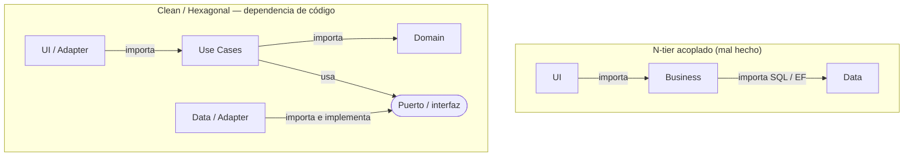
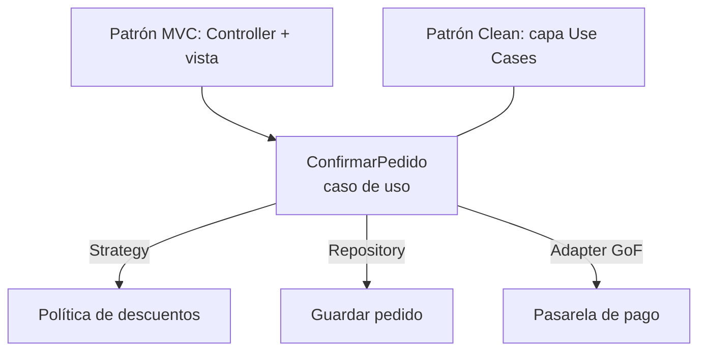
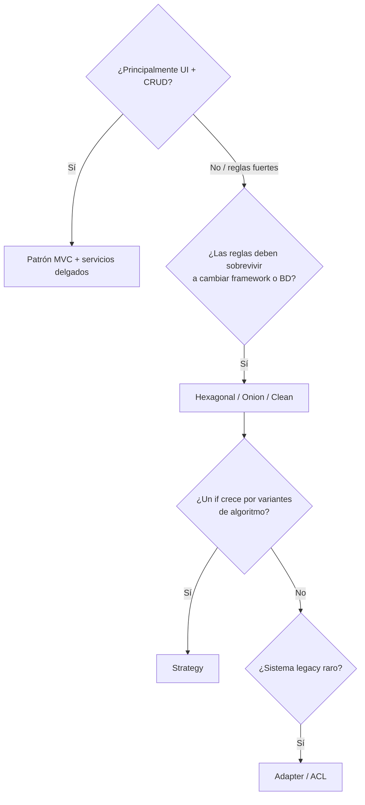

# 5. Comparaciones y guía de decisión

## 5.1 MVC vs Hexagonal / Onion / Clean

| | **MVC** | **Hexagonal / Onion / Clean** |
|--|---------|-------------------------------|
| Alcance | Separar UI (Model–View–Controller) | Proteger dominio e inversión de dependencias |
| Centro | A menudo el Model (a veces hinchado) | Entities + Use Cases |
| BD / frameworks | Fácil que se filtren al Model | Quedan en adapters / infraestructura |
| ¿Suficiente solo? | Apps chicas / CRUD | Apps con reglas de negocio y longevidad |
| Relación | Puede ser el **adaptador de UI** de las otras | Pueden **incluir** MVC en el borde |

MVC y Clean no se excluyen: Hexagonal/Clean organizan la aplicación; MVC (o similar) puede quedar en el borde web.

---

## 5.2 Hexagonal vs Onion vs Clean

| Criterio | Hexagonal | Onion | Clean |
|----------|-----------|-------|-------|
| Metáfora | Puertos y adaptadores | Capas concéntricas | Anillos + use cases |
| Pieza estrella | Puerto / Adapter | Domain Model en el centro | Use Case + Dependency Rule |
| ¿Dominio aislado? | Sí | Sí | Sí |
| ¿Diferencia práctica? | Vocabulario de bordes | Vocabulario de capas | Vocabulario de casos de uso + testing |

No son idénticos, pero comparten la idea de dependencias hacia el dominio:

1. Dominio sin frameworks.  
2. Dependencias hacia adentro.  
3. Flujos de aplicación testeables sin UI ni BD reales.

---

## 5.3 Capas clásicas (N-tier) vs Clean/Hexagonal



En Clean/Hex el caso de uso **usa** un puerto; el adaptador de datos lo **implementa**. El dominio/aplicación **no** importa SQL.

| | N-tier acoplado | Clean / Hexagonal |
|--|-----------------|-------------------|
| Cambiar BD | Duele el “business” | Cambias un adapter |
| Tests de reglas | Necesitan BD | Memoria / fakes |
| Riesgo | Lógica en controllers y repos | Over-engineering en apps triviales |

---

## 5.4 Patrón arquitectónico vs patrón de diseño (ejemplo)

Mismo flujo, dos niveles de patrón:



- **MVC / Clean** = patrones **arquitectónicos**.  
- **Strategy / Adapter** = patrones de **diseño** (GoF). **Repository** = patrón de aplicación (PoEAA).  
Los de grano fino **habitan dentro** del arquitectónico; no lo reemplazan.

---

## 5.5 Cuándo usar qué

La tabla detallada está en [01-patrones-arquitectonicos.md](01-patrones-arquitectonicos.md) §1.8. Resumen:

| Situación | Enfoque |
|-----------|---------|
| UI + CRUD / prototipo | MVC |
| Varias integraciones o canales | Hexagonal |
| Dominio de negocio rico | Onion o Clean |
| Longevidad y tests sin frameworks | Clean o Hexagonal |

**Señales de falta de aislamiento:** controllers enormes; no se puede testear sin BD; cambiar de motor de BD toca todo el código; la misma regla copiada en varios endpoints.

**Señales de exceso:** muchas interfaces para un formulario simple; CQRS/Event Sourcing en un blog; carpetas “Clean” sin reglas de negocio.

---

## 5.6 Tabla de decisión



---

## 5.7 Mismo ejemplo en dos enfoques

**Negocio:** confirmar un pedido y cobrar.

### Solo MVC (riesgo de mezcla)

```ts
class PedidoController {
  async confirmar(req, res) {
    // valida, calcula descuento, SQL, llama Stripe, renderiza...
  }
}
```

### Hexagonal (con MVC en el borde)

```ts
// Adaptador de entrada (HTTP / MVC)
class PedidoController {
  constructor(private confirmar: ConfirmarPedido) {}
  async post(req, res) {
    const out = await this.confirmar.ejecutar(req.body);
    res.json(out);
  }
}

// Flujo de aplicación (núcleo hexagonal)
class ConfirmarPedido {
  constructor(
    private pedidos: PedidoRepository,
    private pagos: PasarelaPago,      // puerto
    private descuento: PoliticaDesc   // Strategy (diseño)
  ) {}
  async ejecutar(input: ConfirmarInput) { /* dominio + puertos */ }
}
```

### Resultado

- Controller delgado.  
- Reglas testeables.  
- Stripe/SQL reemplazables.  
- Separación clara entre patrón de diseño y patrón arquitectónico.

---

## 5.8 Errores frecuentes

1. Confundir el **nombre propio** (*Clean Architecture*) con la categoría (**patrón arquitectónico**).  
2. Creer que **MVC basta** para aislar dominio y BD.  
3. Copiar **carpetas Clean** sin la regla de dependencia.  
4. Poner **SQL en entidades**.  
5. Usar **todos los GoF** en un proyecto pequeño.  
6. Etiquetar como Clean un proyecto donde el **dominio importa** el framework.

---

## 5.9 Resumen

1. **Arquitectura de software** = disciplina que aplica decisiones a un sistema.  
2. **Patrón arquitectónico** = organización en capas (MVC, Hexagonal, Onion, Clean).  
3. **Patrón de diseño** = clases/objetos (GoF). **Patrón de aplicación** = Repository, DTO… (PoEAA y similares).  
4. Hexagonal, Onion y Clean comparten dominio aislado; MVC puede ir en el borde de UI.  
5. La elección depende del **problema** (CRUD vs reglas e integraciones), no del diagrama.

---

**Anterior:** [04-otros-patrones.md](04-otros-patrones.md) · **Índice:** [README.md](README.md)
