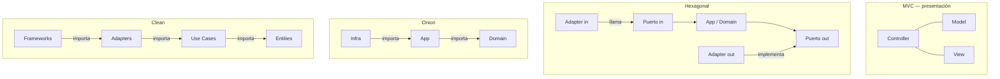

  

<strong>Nociones patrones arquitectónicos y diseño</strong> · Pascual Bravo · Versión 2026-II

# Cheatsheet

## Vocabulario

| Término | En una línea |
|---------|----------------|
| Arquitectura de software | Disciplina de organizar un sistema |
| Patrón arquitectónico | MVC / Hexagonal / Onion / Clean (capas + imports) |
| Patrón de diseño | Solución local clases/objetos (sobre todo GoF) |
| Patrones PoEAA / similares | Repository, DTO, UoW… (grano fino, no = MVC/Clean) |
| Caso de uso | Flujo de negocio en código (mismo rol: Interactor / Application Service) |
| Puerto | Interfaz en el borde |
| Adaptador (Hex/Clean) | Primario *llama* al puerto; secundario lo *implementa* (≠ Adapter GoF) |
| Adapter (GoF) | Clase que traduce interfaz A → B |
| Dependencia de código | Quién **importa** a quién |
| Flujo de ejecución | Quién **llama** a quién en runtime |
| DIP | Principio: depender de abstracciones |
| DI | Técnica de inyección (no es GoF; ayuda a DIP) |

## Patrones arquitectónicos

## GoF — los 6 frecuentes

| Patrón | Para qué |
|--------|----------|
| Factory Method | Subclase decide qué objeto crear (≠ Simple Factory) |
| Strategy | Intercambiar algoritmos |
| Adapter | Encajar interfaz A en B |
| Observer | Notificar a varios interesados |
| Decorator | Añadir comportamiento envolviendo |
| Facade | Simplificar un subsistema |

## Otros del día a día

`Repository` · `DI` · `DTO` · `Unit of Work` · `ACL` · `CQRS*`  
\*solo si lectura/escritura realmente se separan

## Observación

1. Primero el **patrón arquitectónico** (cómo se parte la app).  
2. Dentro, patrones de diseño y de aplicación (cómo colaboran las clases).  
3. MVC puede combinarse con Hexagonal/Onion/Clean en el borde de UI.  
4. Hexagonal, Onion y Clean: misma idea central (dominio aislado), no el mismo patrón.  
5. “Hacia adentro” = **quién importa a quién**, no el orden del request HTTP.

## Cuándo qué

| Si… | Entonces… |
|-----|-----------|
| UI + CRUD / prototipo | MVC |
| Varias integraciones o canales | Hexagonal |
| Dominio de negocio rico | Onion o Clean |
| Longevidad y tests sin frameworks | Clean o Hexagonal |
| Variantes de algoritmo | Strategy |
| Persistencia desacoplada | Repository + DI |

## Errores frecuentes

- Carpetas Clean vacías sin reglas de negocio  
- Lógica de negocio en el controller  
- Dominio que importa el framework  
- Confundir DI (técnica) con DIP (principio)  
- Tratar MVC como suficiente para aislar dominio y BD
